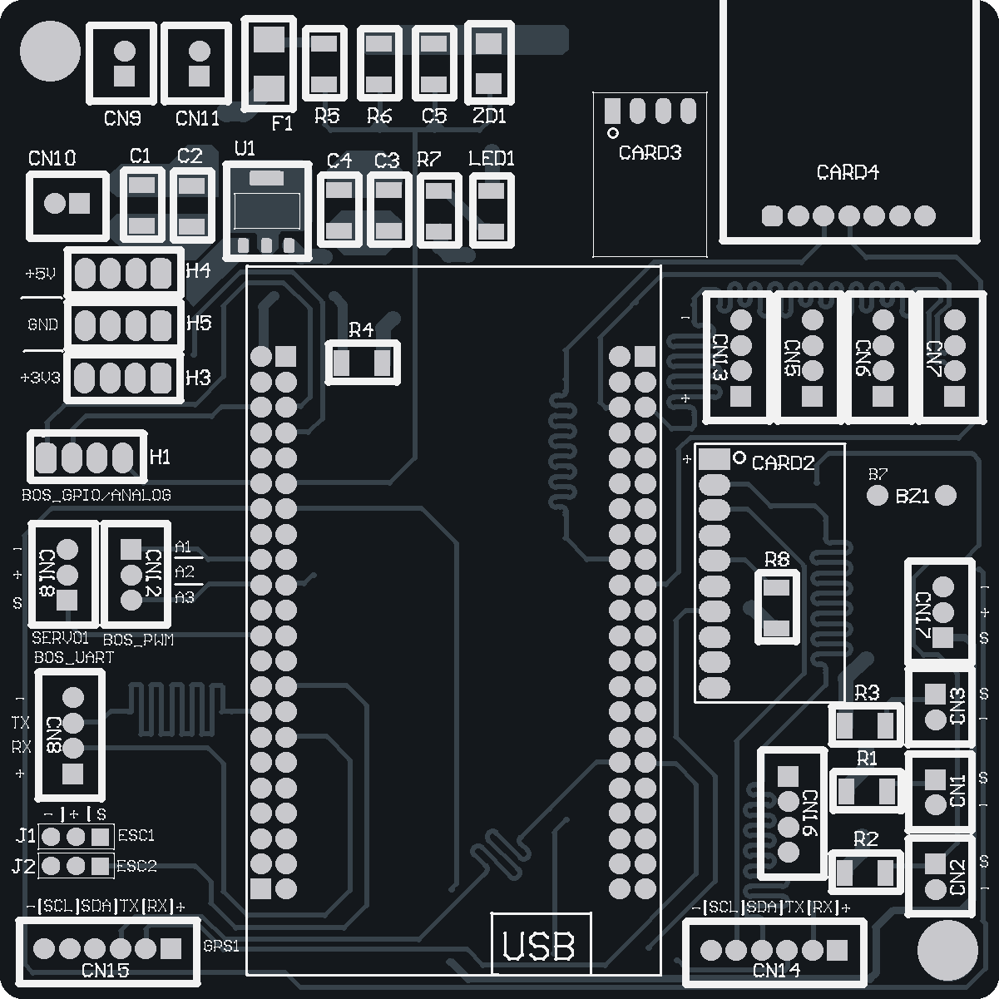
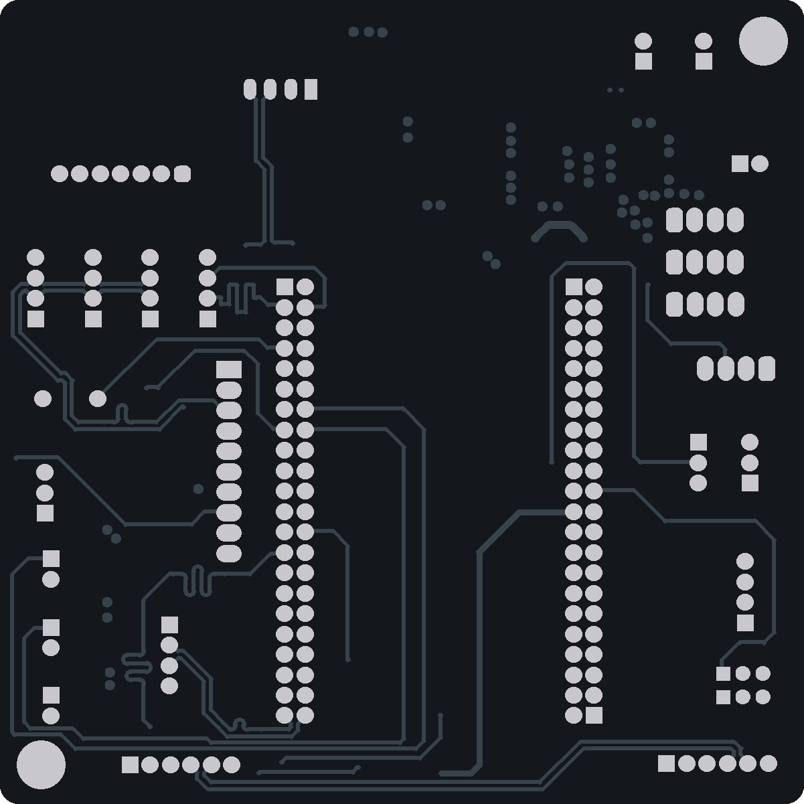
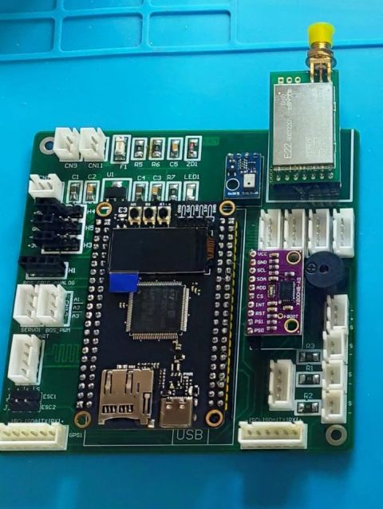

# İDA Ana Kontrol Kartı — MGM NAVARİS (TEKNOFEST 2025)

İnsansız Deniz Aracı (İDA / *Unmanned Surface Vehicle, USV*) için Altium Designer'da tasarlanmış **4 katmanlı ana kontrol kartı**. Kart, aracın tüm sensör, haberleşme ve tahrik arayüzlerini tek bir taşıyıcı (*carrier board*) üzerinde toplar; işlemci olarak **STM32H723VGT6** tabanlı bir geliştirme kartı üzerine oturur.

Kart, MGM NAVARİS takımının TEKNOFEST 2025 İnsansız Deniz Aracı yarışmasında kullandığı araç için geliştirilmiştir. Araç Pixhawk/ArduPilot gibi hazır bir uçuş kontrolcüsü yerine **kendi kartı ve kendi kontrol yazılımıyla** çalışır.

<p align="center">
  
  
</p>
<p align="center"><sub>Üretim Gerber dosyalarından oluşturulmuş üst ve alt yüz görünümü (alt yüz aynalanmıştır).</sub></p>


<p align="center">
  
</p>

---

## İçindekiler

- [Öne Çıkanlar](#öne-çıkanlar)
- [Sistem Mimarisi](#sistem-mimarisi)
- [Kart Özellikleri](#kart-özellikleri)
- [Şematik Sayfaları](#şematik-sayfaları)
- [Güç Mimarisi](#güç-mimarisi)
- [Konnektörler ve Arayüzler](#konnektörler-ve-arayüzler)
- [Katman Yapısı ve Üretim](#katman-yapısı-ve-üretim)
- [Tasarım Kuralları (DRC)](#tasarım-kuralları-drc)
- [Repo Yapısı](#repo-yapısı)
- [Dosyaları Açma](#dosyaları-açma)
- [Bilinen Sorunlar ve Sonraki Revizyon](#bilinen-sorunlar-ve-sonraki-revizyon)
- [Yazar](#yazar)

---

## Öne Çıkanlar

- **MCU:** STM32H723VGT6 (Arm Cortex-M7, 550 MHz) — geliştirme kartı, 2×dişi pin header ile karta takılır
- **4 katman**, 100 × 100 mm, 1.6 mm FR-4, SIG / PWR / GND / SIG dizilimi
- **Haberleşme:** LoRa E22 telemetri modülü, RC kumanda alıcısı (UART), görüntü işleme bilgisayarı ile UART bağlantısı
- **Sensörler:** BNO08x 9 eksen IMU, AHT10 sıcaklık/nem, 2 × GPS (M10N) girişi
- **Tahrik:** 2 × ESC PWM çıkışı, servo (spoyler) çıkışları, yedek PWM kanalları
- **Güvenlik:** güvenlik anahtarı, start butonu ve akım kesici (*kill switch*) girişleri, batarya gerilim ölçümü, buzzer
- Altium DRC: **0 ihlal, 0 uyarı**

---

## Sistem Mimarisi

Araç, 6S Li-ion batarya (24 V nominal) ile beslenir. Ana güç hattı 130 A katı hal sigorta ve akım kesiciden geçerek iki adet 50 A ESC üzerinden su altı iticilerine (*thruster*) gider. Elektronik için 24 V hattan 12 V, 5 V ve 3.3 V regüle edilir.

STM32H7 kart aracın merkezindedir:

| Alt sistem | Bileşen | Arayüz |
|---|---|---|
| Konum | 2 × M10N GPS | UART + I2C (pusula) |
| Yönelim | BNO08x IMU | I2C + INT |
| Ortam | AHT10 sıcaklık/nem | I2C |
| Telemetri | LoRa E22 | UART |
| Manuel kontrol | RC alıcı (ELRS / SBUS) | UART |
| Görüntü işleme | Jetson Nano (+ derinlik kamerası) | UART |
| Tahrik | 2 × 50 A ESC | PWM |
| Uyarı | Aktif buzzer | GPIO |

> **Not:** Blok diyagram sistemin genel mimarisini gösterir; OLED ekran, SD kart gibi bazı bloklar bu kart revizyonunda yer almaz. Güncel bağlantılar için şematik sayfaları esas alınmalıdır.

---

## Kart Özellikleri

| Parametre | Değer |
|---|---|
| Boyut | 100.03 × 100.03 mm, köşeler yuvarlatılmış |
| Katman sayısı | 4 |
| Kalınlık | 1.6 mm |
| Malzeme | FR-4, TG 135–140 |
| Bakır | Dış katman 1 oz, iç katman 0.5 oz |
| Min. iz genişliği / aralık | 10 mil / 10 mil (0.254 mm) |
| Min. via | 0.3 mm delik / 0.45 mm pad |
| Yüzey kaplama | HASL (kurşunlu) |
| Lehim maskesi / serigrafi | Siyah / Beyaz |
| Montaj | 2 × M3 delik (çapraz köşeler) |
| Toplam delik | 259 (tamamı PTH) |
| Tasarım aracı | Altium Designer 23.8 |

---

## Şematik Sayfaları

Proje hiyerarşik değil, düz (*flat*) çok sayfalı bir şematik yapısındadır. Sayfalar arası bağlantılar net etiketleri (*net label*) ile yapılır.

| Sayfa | Dosya | İçerik |
|---|---|---|
| 1 | `2025_İDA_Blok_Diyagram.SchDoc` | Sistem blok diyagramı |
| 2 | `STM32_Karti_Ve_Bağlantilari.SchDoc` | STM32H723 geliştirme kartı soketi, I2C/UART/PWM konnektörleri, güvenlik girişleri, montaj delikleri |
| 3 | `Guc_Devreleri.SchDoc` | Güç girişi ve dağıtımı, 5 V → 3.3 V LDO, batarya gerilim ölçümü |
| 4 | `Sensorler.SchDoc` | IMU, sıcaklık/nem, 2 × GPS, görüntü işleme ünitesi bağlantısı |
| 5 | `Haberlesme.SchDoc` | LoRa E22, kumanda alıcısı |
| 6 | `Kontrol_Devreleri.SchDoc` | ESC çıkışları, spoyler servosu, buzzer |

---

## Güç Mimarisi

```
6S Li-ion (≈24 V) ──► CN9 / CN11 (Batarya girişi)
                          │
                          ├──► R5/R6 bölücü + C5 + ZD1 ──► PC0 (ADC) : batarya gerilimi ölçümü
                          └──► F1 (500 mA sigorta)

Harici 24 V → 5 V buck ──► CN10 (5 V girişi)
                          ├──► H4  : 5 V dağıtım header'ı
                          ├──► 5 V sensör / modül beslemeleri
                          └──► U1 AMS1117-3.3 (LDO) ──► H3 : 3.3 V dağıtım header'ı
                                                        └► 3.3 V sensör beslemeleri
H5 : GND dağıtım header'ı · LED1 : besleme göstergesi
```

- 5 V, kart dışındaki bir buck dönüştürücüden gelir; kart üzerinde yalnızca 5 V → 3.3 V lineer regülasyon vardır.
- AMS1117-3.3 için giriş/çıkışta 10 µF + 1 µF (1206) kondansatörler kullanılmıştır.
- Batarya gerilimi 1 MΩ / 200 kΩ direnç bölücü ile ölçülür; bölücü çıkışı Zener diyot ile sınırlanır ve kondansatör ile filtrelenir.

---

## Konnektörler ve Arayüzler

Serigrafide konnektör pin sıraları belirtilmiştir (ör. `- | SCL | SDA | TX | RX | +`).

| Ref. | Tip | Fonksiyon |
|---|---|---|
| CARD1 | 2 × dişi header | STM32H723VGT6 geliştirme kartı (USB kenara bakar) |
| CN9, CN11 | 2-pin JST | Batarya girişi |
| CN10 | 2-pin JST | 5 V girişi |
| H3 / H4 / H5 | 4-pin dişi header | 3.3 V / 5 V / GND dağıtım |
| H1 | 4-pin dişi header | Yedek GPIO / analog |
| CN14, CN15 | 6-pin JST | GPS 1 / GPS 2 (UART + I2C + besleme) |
| CN5, CN6, CN7 | 4-pin JST | I2C_1 / I2C_2 / I2C_3 |
| CN16 | 4-pin JST | Görüntü işleme ünitesi (UART) |
| CN13 | 4-pin JST | RC kumanda alıcısı (UART) |
| CN8 | 4-pin JST | Yedek UART (UART7) |
| CARD2 | Modül soketi | BNO08x IMU (I2C + INT) |
| CARD3 | Modül soketi | AHT10 sıcaklık/nem (I2C) |
| CARD4 | Modül soketi | LoRa E22 telemetri (UART) |
| J1, J2 | 3-pin header | ESC 1 / ESC 2 PWM (`- + S`) |
| CN17, CN18 | 3-pin JST | Servo çıkışları (spoyler) |
| CN12 | 3-pin JST | Yedek PWM (PA1 / PA2 / PA3) |
| CN1, CN2, CN3 | 2-pin JST | Güvenlik anahtarı, start butonu, akım kesici (10 kΩ pull direnci ile) |
| BZ1 | THT | 5 V aktif buzzer (PB7) |

**Kullanılan MCU sinyalleri (net etiketlerinden):**

| Grup | Pinler |
|---|---|
| PWM | PA1, PA2, PA3, PA5, PA6, PA7, PB0, PB7 |
| Analog | PC0 (batarya), PC1 |
| GPIO / Kesme | PC2 (IMU INT), PC3, PD3, PD4, PD5, PE4, PE5, PE6 |
| Haberleşme | 2 × GPS UART, LoRa UART, kumanda UART, görüntü işleme UART, yedek UART, I2C |

> Ayrıntılı pin-çevre birimi eşleşmesi için `STM32_Karti_Ve_Bağlantilari.SchDoc` sayfasına bakınız.

---

## Katman Yapısı ve Üretim

| Katman | Gerber | İşlev |
|---|---|---|
| L1 – Signal_1 | `.GTL` | Üst sinyal + bileşenler |
| L2 – Power | `.GP1` | Güç düzlemi |
| L3 – Ground | `.GP2` | Toprak düzlemi |
| L4 – Signal_2 | `.GBL` | Alt sinyal |

Kart JLCPCB'de **JLC04161H-3313** stack-up ile üretilecek şekilde hazırlanmıştır (empedans kontrolü yok, via'lar plugged, flying probe elektriksel test).

**Delik tablosu (NC Drill):**

| Çap | Adet | Kullanım (tahmini) |
|---|---|---|
| 0.305 mm | 18 | Via |
| 0.61 mm | 49 | Via / küçük pin |
| 0.8 mm | 44 | Header pinleri |
| 0.9 mm | 57 | Header / JST pinleri |
| 1.0 mm | 83 | Header / JST pinleri |
| 1.07 mm | 6 | Konnektör |
| 3.0 mm | 2 | M3 montaj deliği |

---

## Tasarım Kuralları (DRC)

Altium Design Rule Check raporu: **0 ihlal, 0 uyarı.**

| Kural | Değer |
|---|---|
| Clearance | 10 mil |
| İz genişliği | min 10 mil, maks 100 mil |
| Hole-to-hole | 10 mil |
| Solder mask sliver | 10 mil |
| Silk-to-mask | 6 mil |
| Silk-to-silk | 10 mil |
| Power plane bağlantısı | Direct connect, 20 mil genişleme |
| Kısa devre / bağlanmamış net / net anteni | 0 |

---

## Repo Yapısı

```
IDA-PCB/
├── İDA_2025_karti.PrjPcb                 # Altium proje dosyası
├── 2025_İDA_Blok_Diyagram.SchDoc         # Sayfa 1 – Blok diyagram
├── STM32_Karti_Ve_Bağlantilari.SchDoc    # Sayfa 2 – MCU ve bağlantılar
├── Guc_Devreleri.SchDoc                  # Sayfa 3 – Güç devreleri
├── Sensorler.SchDoc                      # Sayfa 4 – Sensörler
├── Haberlesme.SchDoc                     # Sayfa 5 – Haberleşme
├── Kontrol_Devreleri.SchDoc              # Sayfa 6 – Kontrol devreleri
├── 2025_İDA_PCB_KARTI.PcbDoc             # PCB yerleşim dosyası
├── 2025_İDA_PCB_KARTI.step               # 3B model (mekanik entegrasyon için)
└── docs/images/                          # README görselleri
```

---

## Dosyaları Açma

- **Altium Designer** (23.x veya üzeri): `İDA_2025_karti.PrjPcb` dosyasını açın; tüm şematik ve PCB dosyaları projeye bağlıdır.
- **Altium yoksa:** dosyaları ücretsiz [Altium 365 Viewer](https://www.altium.com/viewer/) ile tarayıcıda görüntüleyebilirsiniz.
- **KiCad:** KiCad'in Altium içe aktarma aracı (*Import Non-KiCad Project*) ile açılabilir; kütüphane ve kural dönüşümünde farklılıklar olabilir.
- **Mekanik:** `2025_İDA_PCB_KARTI.step` dosyası Fusion 360, SolidWorks, FreeCAD vb. CAD araçlarında gövde/kutu entegrasyonu için kullanılabilir.

---

## Bilinen Sorunlar ve Sonraki Revizyon

- **BNO08x pin sırası:** IMU modülünün pinout'u footprint'te hatalı alınmış, kart üzerinde harici kablolama ile düzeltilmiştir. Sonraki revizyonda footprint düzeltilecektir.
- **Modül tabanlı yapı:** MCU, IMU ve sıcaklık sensörü hazır modüller üzerinden bağlanır. Hedef, bu modüllerin doğrudan kart üzerine (*chip-down*) tasarlanmasıdır.
- **Yerlileştirme hedefleri:** görüntü işleme bilgisayarı, 50 A çift yönlü ESC ve gerilim regülatörlerinin takım içinde tasarlanması.

---

## Yazar

**Mustafa Mücahit Çillioğlu** — Elektrik-Elektronik Mühendisi, MGM NAVARİS İDA Takımı Elektronik Takım Kaptanı

[LinkedIn](https://www.linkedin.com/in/mmucahitc) · [GitHub](https://github.com/mucahitc)
